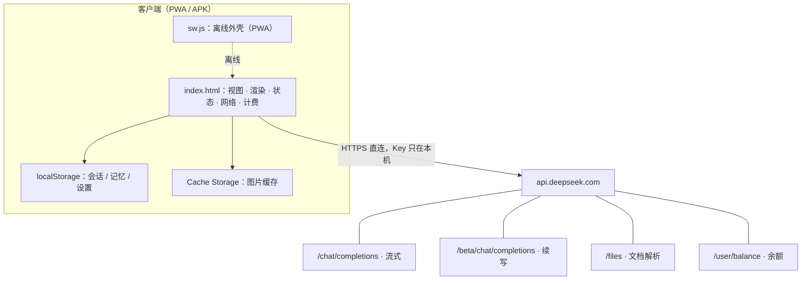

# 轻言 Pico

> 2 MB 的 DeepSeek 轻客户端。自带 API Key，数据只存本机，直连官方 API。
>
> 安卓装 APK，iPhone、鸿蒙 NEXT 与电脑用网页版；官方导出的历史对话可整包导入。
>
> 个人开发版本，与 DeepSeek 官方无关，也不代表官方立场，仅供社区自用与学习参考。
> 针对 2026 年 11 月 DeepSeek C 端限额政策重新设计：不受每日对话额度、4 万字单次输入、7 天闲置会话失效的限制。

**下载**：[下载页](https://suxiangyu.top/download/) · [Gitee Release](https://gitee.com/suxiangyu138/qingyan-pico/releases) · [GitHub Release](https://github.com/suxiangyu138/qingyan-pico/releases)

**在线使用**：[网页版](https://suxiangyu.top/app/)

**源码**：[Gitee](https://gitee.com/suxiangyu138/qingyan-pico) · [GitHub](https://github.com/suxiangyu138/qingyan-pico)

  

---

## 一、它解决什么问题

2026 年 11 月 16 日起，DeepSeek 对 App 与网页版的免费用户收紧用量：单次输入压到约 4 万字，存续超过 7 天且无活跃交互的长对话不再支持接续，每日另设对话额度，触顶后提示「使用额度已达上限」。

官方 API 是另一套规则：按量计费、独立并发限制，不受 C 端限额影响，模型能力一致，上下文同样是 1M。

同一个模型，走 App 会被限流，走 API 不会。轻言就是把这个错位补上：用自己的 Key 直接调用官方 API，把对话数据留在本机。

| 维度 | 官方 App / 网页版 | 轻言 |
|---|---|---|
| 每日额度 | 有上限，触顶停用 | 无，按 API 用量计费 |
| 单次输入 | 约 4 万字 | 受模型 1M 上下文限制 |
| 闲置会话 | 7 天未活跃可能无法接续 | 永久保留，存在本机 |
| 上下文 | 受限 | 1M，顶栏实时显示占用 |
| 数据 | 存在服务端 | 只存本机 |
| 联网 / 思考 | 服务端能力 | 同一个服务端工具接口 |

参考报道：

- [DeepSeek 成立以来首次限制免费用户（21 世纪经济报道）](https://m.21jingji.com/article/20261118/9955e792673f679b6ba6e29b0fae1c91.html)
- [DeepSeek 开始限制使用（光明网）](https://m.gmw.cn/2026-11/16/content_1304586782.htm)
- [调用量冲上全球第一，DeepSeek 开始对免费用户限额（央广网）](https://tech.cnr.cn/techds/20261117/t20261117_527875325.shtml)

---

## 二、方向与边界

这个项目的主导方向只有一句话：**做最轻的 DeepSeek 对话客户端。**

轻不是体积数字，是取舍标准。每加一个功能，都要先回答两个问题：它是不是围绕「和模型对话」这件事本身的？能不能用一句话说清它解决了什么麻烦？答不上来的就不做。

### 2.1 做什么

- 把对话体验做顺：流式输出、推理强度、图片与文档、记忆、导出
- 把成本做透明：每条回答的 token、缓存命中、费用，顶栏的上下文占用
- 把数据留在本机：无账号、无同步、无中转
- 把体积压住：单文件前端，无框架，无构建步骤，无 npm 依赖

### 2.2 不做什么

| 不做 | 原因 |
|---|---|
| Agent 编排、工具市场、插件系统 | 那是另一个产品，塞进来会让界面和心智都变重 |
| 多模型路由、供应商中转 | 只需要一把 DeepSeek 的钥匙，多一层就多一层问题和风险 |
| 账号体系、云同步、团队协作 | 数据不出设备是这个项目的前提，不是可选项 |
| 引入前端框架与构建链 | 现在改一行样式就能直接生效，这个手感值得守住 |
| 为了功能数量堆设置项 | 设置越厚，新人越难开始 |

### 2.3 体量标准

体积不是唯一目标，做得小是为了快、好维护，不是为了数字好看。

| 指标 | 当前 | 参考区间 |
|---|---|---|
| `app/index.html` | 180 KB | 300 KB 以内，超过先考虑拆文件 |
| APK | 2.0 MB | 单次发版增量超过 200 KB 要在变更记录里说明 |
| 冷启动 | 约 105 ms | 300 ms 以内，这是真正要守的线 |
| 运行时依赖 | 0 | 保持 0，不引入框架与 npm 包 |

判断一个功能要不要加，看的是启动速度和维护成本，不是安装包大小。几 MB 的安装包对今天的手机不算负担，慢一秒启动才是负担。

### 2.4 判断标准

一个改动值不值得做，按顺序问：

1. 它让「问一个问题、拿到好答案」变快了吗
2. 它会让启动变慢、让这份单文件变难读吗
3. 删掉它，有多少人真的会难受

三个答案都过关才动手。这条标准优先于任何功能清单。

## 三、三种用法，按设备选

| 设备 | 用哪个 | 安装方式 |
|---|---|---|
| 安卓 8.0 及以上 | APK，约 2 MB | 下载安装包，允许未知来源 |
| 鸿蒙 4.x 及以下 | APK | 同上，兼容层直接跑 |
| 鸿蒙 NEXT 5.x | 网页版 | 浏览器打开，添加到桌面 |
| iPhone / iPad | 网页版 | Safari 打开，分享 → 添加到主屏幕 |
| 电脑 | 网页版 | 浏览器打开即可 |

纯血鸿蒙（HarmonyOS NEXT）不再兼容 APK，只能走网页版。功能差异见第五节。

### 2.1 安卓安装 APK

1. 打开 [下载页](https://suxiangyu.top/download/)，点「下载 Android 安装包」
2. 安装时允许「未知来源」，部分机型会问是否允许该应用安装应用，选允许
3. 打开后填入自己的 DeepSeek API Key
4. 设置 → 关于 → 检查更新，确认后续版本能正常升级

### 2.2 iOS 添加到主屏幕

1. Safari 打开 [https://suxiangyu.top/app/](https://suxiangyu.top/app/)
2. 点底部「分享」→「添加到主屏幕」
3. 从桌面图标进入，全屏使用，没有地址栏

### 2.3 鸿蒙 NEXT 与桌面

浏览器打开网页版，同样可以添加到桌面。ArkWeb 与桌面 Chrome 是同内核，界面、公式、图表表现一致。

---

## 四、第一次使用

### 3.1 申请 API Key

1. 打开 [platform.deepseek.com](https://platform.deepseek.com/api_keys)
2. 注册并充值（最低 10 元起，按量计费，日常问答一个月通常几块钱）
3. 创建 API Key，复制形如 `sk-xxxx` 的字符串

Key 只存在你自己的设备上，不经过任何服务器，也不会被上传。

### 3.2 填入 Key

首次打开会有引导。之后要改，走 设置（顶栏右侧或抽屉底部）→ 填 Key → 测试连接。

测试连接会依次请求 `/models` 与 `/user/balance`：能看到余额说明 Key 与网络都正常。顶栏的金额按钮点一下也会刷新余额。

---

## 五、功能说明

### 4.1 对话

- 对话概览：会话菜单里一键把整段对话整理成会议纪要，导出 Markdown、TXT、Word、PDF
- 一键原生：设置里打开后只发对话与记忆，不加任何附加提示词，接近官方客户端；关闭即恢复增强模式
- 流式输出，逐字上屏，可随时点停止；上滑阅读时不会被自动滚动打断
- 顶栏模型按钮切换 V4.1 Flash 与 V4 Pro
- 图表可点开放大，支持缩放、拖动与 PNG 导出
- 角色设定：每个会话可选一个自建角色（名称 + 提示词），只作用于当前对话
- 匿名对话：右上角一键开启，只在内存里存在，不写历史、不写记忆、关闭即消失；仍会读取你的个性化与长期记忆
- 「深度思考」开关 + 推理强度：关闭 / 低 / 高 / 最高。档位对齐官方接口的 `reasoning_effort`，官方只提供 low、high、max 三档，默认 high。越高推理 token 越多，费用也越高
- 「联网搜索」开关：模型走服务端工具检索，回答下方列出参考来源
- 输入框支持多行，回车发送（手机上是键盘的发送键）
- 桌面端支持 Ctrl+V 粘贴截图，也支持把文件拖进窗口

### 4.2 加号里的三个附件入口

| 入口 | 行为 | 限制 |
|---|---|---|
| 拍照 | 直接调系统相机，拍完进入待发送队列 | 拍完的临时文件发送后自动清理，不留相册垃圾 |
| 相册 | 系统图片选择器，可多选 | 最多 30 张，发送前自动压缩 |
| 文件 | 文档选择器 | 最多 3 个，单个 30MB 以内 |

文件支持 PDF、Word、PPT、Excel、EPUB，以及 txt / md / csv / json / 各类源码。文档走 Files API 解析，图片走多模态理解。

带图片或文件时模型会自动切到 V4.1 Flash，因为图像理解只有它支持。

### 4.3 会话管理

左上角菜单打开抽屉：

- 搜索框按标题与内容搜索
- 置顶、锁定（置顶或锁定的会话不能删除）
- 长按进入批量选择，可一次删除多条
- 底部显示存储占用，可单独清理图片缓存

### 4.4 记忆

在对话里说「记住：我不吃香菜」这类句子，客户端会把要点归纳进记忆，之后每次对话自动带上。

设置 → 记忆可以查看、编辑、删除每一条；也可以关掉自动归纳，手动维护。

### 4.5 导出

每条回答下方有导出按钮：

- Markdown：保留标题、列表、代码块、公式源码
- 纯文本：去掉所有标记
- PDF：APK 走系统打印服务，网页版走浏览器打印，都能选「另存为 PDF」

长代码在 PDF 里会完整展开换行，不会被聊天界面的高度限制截断。

### 4.6 用量

设置 → 用量：

- 今日、本月、余额三个数
- 今日 / 本月 / 总计三个口径，按天列出 token 与金额，可导出 CSV；累计账本独立存放，删会话不清零
- 金额按接口返回的 usage 估算，缓存命中与错峰时段已计入，最终以官方账单为准

顶栏的「上下文」显示当前会话占用多少，超出 1M 会自动裁掉最旧的消息。

### 4.7 外观

- 主题：跟随系统 / 浅色 / 深色
- 正文字号、代码字号、代码字体（系统 Mono / Cascadia / JetBrains / Fira Code）、整体界面缩放
- 流畅模式：默认开启。关掉毛玻璃、背景光斑动画与消息入场动画，弱化阴影，老机型更稳

### 4.8 备份与恢复

设置 → 存储：

- 导出备份：生成一个 JSON，含全部会话、记忆与设置（不含图片原图）
- 导入备份：覆盖当前数据，导入前会二次确认
- 导入对话：支持本应用备份，也支持 DeepSeek 官方导出的整包 zip 直接导入，全量、按最近使用排序，或解压后的 `chat_sessions/*.json` 多选

建议每月导出一次，尤其是网页版用户。

### 4.9 更新

APK 用户：设置 → 关于 → 检查更新。

检查更新会同时问站点上的 `release.json` 和 Gitee 发行版，取版本高的那个。确认后应用自己下载安装包，系统弹出安装界面，点安装即可覆盖，数据与 Key 都保留。

网页版用户：关掉页面重新打开，或在关于里点「刷新到最新版」。

---

## 六、平台差异

| 能力 | 安卓 APK | iOS / 鸿蒙 NEXT 网页版 |
|---|---|---|
| 对话、模型、思考、搜索 | 有 | 有 |
| 图片、文档、记忆、用量 | 有 | 有 |
| 应用内检查更新 | 有 | 无，刷新页面 |
| 导出文件 | 原生保存到指定目录 | 浏览器下载或系统分享 |
| 打印 / PDF | 系统打印服务 | 浏览器打印 |
| 数据持久性 | 应用私有目录，稳定 | IndexedDB，iOS 可能被系统清理 |

iOS 特别注意：Safari 会定期清理长期未访问站点的脚本存储，久不打开可能丢数据，重要的对话用导出备份留一份。

---

## 七、数据与隐私

- API Key、会话、记忆、图片全部保存在本机，网页版存在浏览器存储，APK 存在应用私有目录
- 唯一的外部请求是 `api.deepseek.com`；检查更新会额外请求站点与 Gitee 的版本文件，只传版本号，不传任何内容
- 没有统计埋点，没有账号体系，没有云端同步，服务器不接触任何对话
- 卸载应用或清除站点数据即删除全部内容

详见 [隐私说明](https://suxiangyu.top/download/privacy.html)。

---

## 八、已知限制

- 只支持 DeepSeek 官方 API，不做第三方服务商中转
- 没有云同步与多设备同步，换机靠备份导入
- 会话存在 IndexedDB，网页版清理站点数据会一并清掉，重要对话记得导出备份
- 网页版依赖 Service Worker 缓存，偶尔会拿到旧版本，强制刷新即可
- 纯血鸿蒙没有原生安装包，只能用网页版
- iOS 没有独立安装包，且存储可能被系统清理
- 消息列表按分页渲染，超长会话需要点「加载更早的消息」

---

## 九、技术实现

单文件前端：`app/index.html` 内联全部 CSS 与 JS，没有构建步骤，没有框架，没有 npm 依赖。



渲染层：先按代码块占位切分文本，再做 Markdown 转换，最后交给 KaTeX（含 mhchem 化学公式）与 Mermaid 渲染；流式输出只重绘新增部分，靠 `requestAnimationFrame` 合并每帧。

APK 层：原生 `WebView` 加载打包进 assets 的同一份 `index.html`，通过 JS 桥提供保存文件、拍照、打印、下载安装包四项能力。

---

## 十、从源码构建 APK

不依赖 Android Studio 与 Gradle，ARM64 的 Ubuntu 上也能出包：

```bash
apt install -y openjdk-17-jdk-headless aapt apksigner zipalign
# 还需要 android-23 的 android.jar 与 R8 的 jar
aapt package -f -M apk/AndroidManifest.xml -S apk/res -A app \
  -I android.jar -F base.apk
javac -source 8 -target 8 -bootclasspath android.jar \
  -d classes apk/src/**/*.java
java -cp r8.jar com.android.tools.r8.D8 --min-api 24 --lib android.jar \
  --output dex classes/**/*.class
zipalign -f 4 base.apk aligned.apk
apksigner sign --ks release.jks --out Pico-X.Y.Z.apk aligned.apk
```

签名必须始终使用同一份 keystore，换了会导致覆盖安装失败、数据丢失。

---

## 十一、项目结构

```
app/                 前端全部资源（单文件 index.html + sw.js + KaTeX + Mermaid）
download/            下载页、隐私说明、release.json
docs/                架构、发行、封装方案
apk/                 Android 清单、Java 源码、图标资源、构建脚本
tools/serve.py       本地开发服务器（带 no-store 与 APK MIME）
tools/sync.sh        同步到手机目录
```

---

## 十二、自建部署

整套系统纯静态，任意静态服务器都能托管：

```
/app/       网页版
/download/  下载页、APK、release.json
```

Nginx 要做四件事：

1. `/app/index.html` 与 `/app/sw.js` 设 `Cache-Control: no-store`，避免 CDN 缓存旧版本
2. `.apk` 的 MIME 设为 `application/vnd.android.package-archive`
3. CSP 至少放行 `connect-src 'self' https://api.deepseek.com data: blob:`，同时允许内联脚本与样式
4. APK 用版本化文件名 `app-X.Y.Z.apk`，`release.json` 的 `url` 指向它

`release.json` 的 `apkUrl` 可以指向任意可下载地址，应用内更新认这个字段。

---

## 十三、版本与发布

当前 v2.1.23，versionCode 59。

- 下载页：[suxiangyu.top/download](https://suxiangyu.top/download/)
- Gitee Release：[releases](https://gitee.com/suxiangyu138/qingyan-pico/releases)
- 变更记录：[CHANGELOG.md](CHANGELOG.md)

APK 命名约定 `Pico-X.Y.Z.apk`，站点上另存一份 `app-X.Y.Z.apk` 供下载页引用。

版本号规则：

- `versionName` 只在正式发版时变，一次发版一个号，不为单个修复单独加号
- 平时改代码只递增 `versionCode`，本地构建安装包自用，不发布、不部署
- 攒够一批改动再统一发版并部署线上
- 当前发行版本：2.1.23；versionCode 59

---

## 十四、许可

本项目以 [MIT](LICENSE) 协议开源，可自由使用、修改、分发，保留版权声明即可。

第三方组件：

- KaTeX — MIT
- Mermaid — MIT
- Cascadia Code — SIL Open Font License 1.1
- JetBrains Mono — SIL Open Font License 1.1
- 其余依赖均为 Android 系统自带组件
